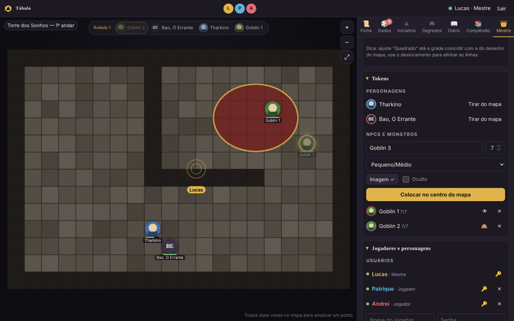
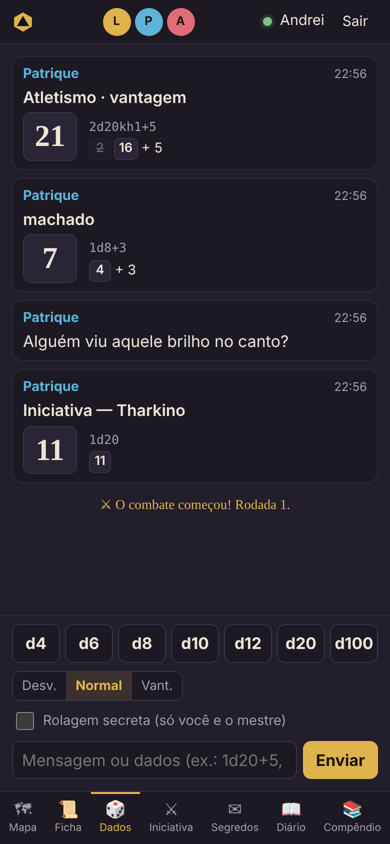

# Tábula

**Mesa virtual de RPG feita para a nossa campanha.** O mestre roda a mesa no próprio computador,
como no Foundry VTT, e os jogadores entram pelo navegador, no PC ou no celular, sem instalar nada.

## O que ela faz

| | |
|---|---|
| 🗺 **Mapa** | Imagem de fundo enviada pelo mestre, grade ajustável, zoom e arrasto (mouse, trackpad ou dedos) |
| ⬤ **Tokens** | Redondos, com a foto do personagem. Cada jogador move só o seu; o mestre move todos, cria monstros, oculta e revela |
| 📜 **Ficha 5e** | Atributos, resistências, perícias, PV com dano/cura, ataques, magias, inventário. Clicar num número rola o dado |
| 🎲 **Dados** | Rolados no servidor: `1d20+5`, `2d6+1d4`, vantagem/desvantagem, rolagem secreta |
| ⚔ **Iniciativa** | Ordem de turnos visível no topo do mapa para todos |
| ✉ **Segredos** | Textos e imagens que o mestre libera só para um jogador (ou alguns, ou todos) |
| 📖 **Diário** | Todo o grupo escreve; cada um edita o que é seu |
| 📚 **Compêndio** | Páginas de consulta do mestre (tabelas de XP, preços, locais), só dele ou visíveis a todos |
| 💾 **Backups** | Salva a cada alteração, guarda pontos de backup e restaura com um clique |
| 📺 **Telão** | Usuário que só vê o mapa, para uma TV no jogo presencial |

## Começar

1. Instale o [Node.js](https://nodejs.org) (versão LTS).
2. Baixe a última versão em **Releases**, ou o código em **Code → Download ZIP**, e descompacte.
3. Dê dois cliques em `instalar.bat` (uma vez só).
4. Para jogar: `iniciar.bat` (mesma casa / mesmo Wi-Fi) ou `online.bat` (amigos em outras casas).

O passo a passo completo, incluindo o jogo online e a resolução de problemas, está em
**[docs/instalacao.md](docs/instalacao.md)**.

## Documentação

- **[Instalação e uso no Windows](docs/instalacao.md)**: instalar, jogar online e presencial, atualizar de versão, problemas comuns
- **[Guia do mestre](docs/guia-do-mestre.md)**: preparar a mesa, cenas e grade, tokens, segredos, compêndio, backups
- **[Guia do jogador](docs/guia-do-jogador.md)**: para mandar aos jogadores (entrar, ficha, dados, diário)
- **[Desenvolvimento](docs/desenvolvimento.md)**: como o código está organizado, testes e como lançar uma versão nova
- **[Histórico de versões](CHANGELOG.md)**

## Onde ficam os dados

A campanha **não** fica no repositório. Ela mora numa pasta `campanha` ao lado das pastas de versão
(`Tabula_v1`, `Tabula_v2`…), então todas as versões abrem a mesma campanha. Veja
[docs/instalacao.md](docs/instalacao.md#onde-fica-a-campanha).

 
