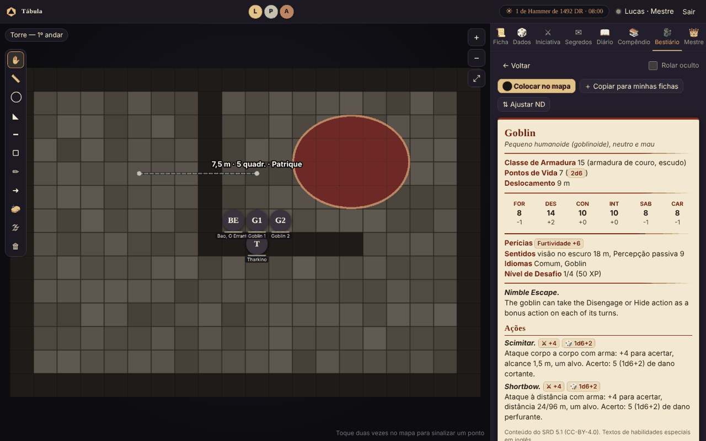
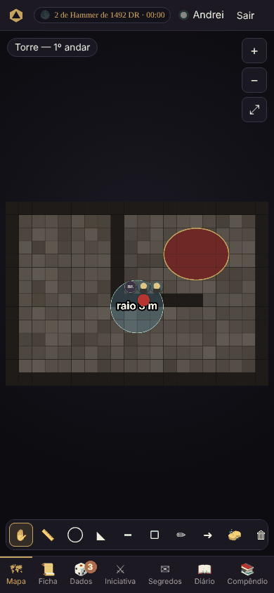

# Tábula

**Mesa virtual de RPG feita para a nossa campanha.** O mestre roda a mesa no próprio computador,
como no Foundry VTT, e os jogadores entram pelo navegador, no PC ou no celular, sem instalar nada.

Página do projeto: **<https://lp-iq.github.io/tabula/>**

## O que ela faz

| | |
|---|---|
| 🗺 **Mapa** | Imagem de fundo enviada pelo mestre, grade ajustável, zoom e arrasto (mouse, trackpad ou dedos) |
| 🌫 **Névoa de guerra** | O mestre revela e esconde partes do mapa; monstros na névoa nem chegam aos jogadores |
| 📏 **Régua e áreas** | Régua em metros e áreas de magia (esfera, cone, linha, cubo), desenho livre e setas, que todos veem |
| ⬤ **Tokens** | Redondos, com a foto do personagem. Cada jogador move só o seu; o mestre move todos, cria monstros, oculta e revela |
| 📜 **Ficha 5e** | Atributos, resistências, perícias, PV com dano/cura, ataques, magias, inventário. Clicar num número rola o dado |
| 🔮 **Mais na ficha** | Condições (aparecem no token), inspiração, testes contra a morte, espaços de magia, dados de vida, XP e moedas, aspecto mágico e anel |
| 🎲 **Dados** | Rolados no servidor: `1d20+5`, `2d6+1d4`, vantagem/desvantagem, rolagem secreta. Cada rolagem aparece num pop-up para todos |
| ⚔ **Iniciativa** | Ordem de turnos visível no topo do mapa para todos |
| ✉ **Segredos** | Textos e imagens que o mestre libera só para um jogador (ou alguns, ou todos), e uma **fila de memórias** para liberar uma por vez |
| 🕰 **Calendário** | Data e hora do mundo no topo (Harptos por padrão, editável), descanso curto e longo para o grupo |
| 📖 **Diário** | Todo o grupo escreve; cada um edita o que é seu |
| 📚 **Compêndio** | Páginas de consulta do mestre (tabelas de XP, preços, locais), só dele ou visíveis a todos |
| 🐉 **Bestiário** | Fichas de NPCs e monstros com ataques roláveis, 334 monstros do SRD prontos, **ajuste de ND**, medidor de dificuldade do encontro e imagens em lote |
| 💾 **Backups** | Salva a cada alteração, guarda pontos de backup e restaura com um clique |
| ⬆ **Atualizar** | `atualizar.bat` (ou `./atualizar.sh`) baixa a versão nova do GitHub sem mexer na campanha; o mestre é avisado quando sai uma |
| 📺 **Telão** | Usuário que só vê o mapa, para uma TV no jogo presencial |

## Começar

Funciona no **Windows**, no **Linux** e no **Mac**. Só o mestre instala.

1. Instale o [Node.js](https://nodejs.org) (versão LTS, 18 ou mais nova).
2. Baixe a última versão em **Releases**, ou o código em **Code → Download ZIP**, e descompacte.
3. Instale (uma vez só) e jogue:

| | Windows (dois cliques) | Linux e Mac (no terminal) |
|---|---|---|
| Instalar | `instalar.bat` | `./instalar.sh` |
| Jogar em casa / mesmo Wi-Fi | `iniciar.bat` | `./iniciar.sh` |
| Jogar pela internet | `online.bat` | `./online.sh` |
| Atualizar (mesa fechada) | `atualizar.bat` | `./atualizar.sh` |

O passo a passo completo, incluindo o jogo online e a resolução de problemas, está em
**[docs/instalacao.md](docs/instalacao.md)** (Windows) e **[docs/instalacao-linux.md](docs/instalacao-linux.md)** (Linux e Mac).

## Documentação

- **[Instalação e uso no Windows](docs/instalacao.md)**: instalar, jogar online e presencial, atualizar de versão, problemas comuns
- **[Instalação e uso no Linux e no Mac](docs/instalacao-linux.md)**: o mesmo, com os atalhos `.sh`
- **[Guia do mestre](docs/guia-do-mestre.md)**: preparar a mesa, cenas e grade, tokens, segredos, compêndio, backups
- **[Guia do jogador](docs/guia-do-jogador.md)**: para mandar aos jogadores (entrar, ficha, dados, diário)
- **[Desenvolvimento](docs/desenvolvimento.md)**: como o código está organizado, testes e como lançar uma versão nova
- **[Histórico de versões](CHANGELOG.md)**

## Onde ficam os dados

A campanha **não** fica no repositório. Ela mora numa pasta `campanha` ao lado da pasta da Tábula,
então atualizar (ou ter várias versões lado a lado) nunca mexe nela. Veja
[docs/instalacao.md](docs/instalacao.md#onde-fica-a-campanha).

 

## Licenças

Código sob licença MIT. A biblioteca de monstros (`public/data/srd-monstros.json`) inclui material do
*System Reference Document 5.1* ("SRD 5.1") da Wizards of the Coast LLC, disponível em
<https://dnd.wizards.com/resources/systems-reference-document>, licenciado sob
[Creative Commons Attribution 4.0 International](https://creativecommons.org/licenses/by/4.0/legalcode).
Dados estruturados do projeto [5e-bits/5e-database](https://github.com/5e-bits/5e-database) (MIT).
