# Manual das ferramentas

Como usar cada parte da Tábula, do mapa à mochila. Para instalar e abrir a mesa, veja a
[instalação no Windows](instalacao.md) ou a [instalação no Linux e no Mac](instalacao-linux.md).
O que mudou em cada versão está nas [novidades](novidades.md).

👑 marca o que só o **mestre** faz. O resto vale para todos (o telão só assiste).

**Sumário:**
[Mapa](#mapa) ·
[Ferramentas do mapa](#ferramentas-do-mapa) ·
[Névoa de guerra](#-névoa-de-guerra-) ·
[Vista 3D](#vista-3d) ·
[Ficha](#ficha) ·
[Multiclasse](#multiclasse) ·
[Equipamento e mochila](#equipamento-e-mochila) ·
[Dados](#dados) ·
[Iniciativa](#iniciativa) ·
[Segredos e fila de memórias](#segredos-e-fila-de-memórias) ·
[Diário e compêndio](#diário-e-compêndio) ·
[Biblioteca: magias e itens](#biblioteca-magias-e-itens) ·
[Calendário e descansos](#calendário-e-descansos-) ·
[Bestiário](#bestiário-) ·
[Painel do mestre](#painel-do-mestre-) ·
[Atalhos de teclado](#atalhos-de-teclado)

---

## Mapa

| Para… | No computador | No celular |
|---|---|---|
| Andar pelo mapa | arraste o fundo | arraste com um dedo |
| Aproximar e afastar | rodinha do mouse ou pinça do trackpad | pinça com dois dedos |
| Ver o mapa inteiro | botão **⤢** | botão **⤢** |
| Mover o seu token | arraste o token (ele encaixa na grade) | arraste o token |
| Andar um quadrado | clique no token e use as **setas** | — |
| Sinalizar um ponto ("olha aqui!") | **dois cliques** no fundo do mapa | dois toques |
| Abrir a ficha de um personagem | **dois cliques no token** | dois toques no token |

- Cada jogador move **só o próprio token**. O mestre move todos.
- Dois cliques no token de um colega abrem só o retrato, a vida, as condições e o equipamento dele.
  👑 Dois cliques num monstro com ficha abrem o bloco de estatísticas.
- Os jogadores veem a barra de vida dos personagens; dos monstros, só um aro vermelho quando estão
  com metade da vida ou menos, e o token cinza com ✖ quando caem.

### Condições nos tokens
As condições (envenenado 🤢, caído ⤵, amedrontado 😱, concentração 🔮…) aparecem como ícones no token,
para todos. O jogador marca na própria ficha; 👑 o mestre marca clicando no token e escolhendo no painel.

---

## Vista 3D

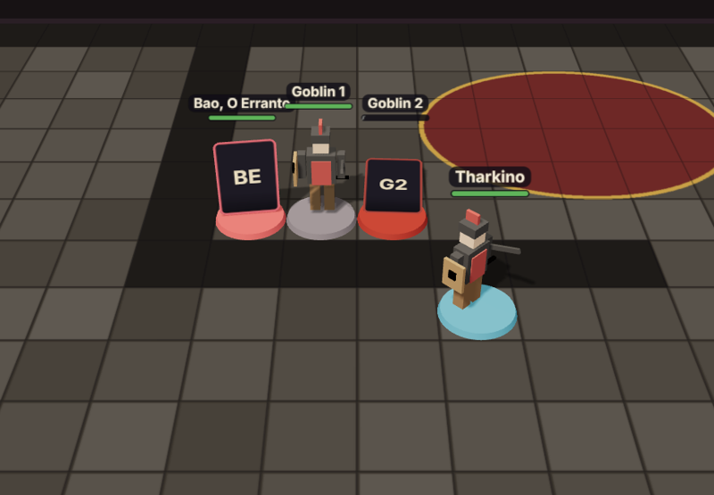

O botão **3D** (abaixo do ⤢, no canto do mapa) transforma o mapa num tabuleiro: o mapa da cena vira o chão e cada
token vira uma **miniatura**. Cada pessoa liga ou desliga para si (a escolha fica guardada no navegador); dá para o
mestre jogar em 2D e a TV mostrar em 3D, por exemplo.

| Para… | No computador | No celular |
|---|---|---|
| Andar pelo tabuleiro | arraste o fundo | arraste com um dedo |
| Girar a câmera | arraste com o **botão direito** | gire com **dois dedos** |
| Aproximar e afastar | rodinha do mouse, **+** e **−** | pinça com dois dedos |
| Vista de cima ⇄ inclinada | botão **⊙** | botão **⊙** |
| Ver o mapa inteiro | botão **⤢** | botão **⤢** |
| Mover o seu token | arraste a miniatura (ela anda até lá e encaixa na grade) | arraste a miniatura |
| Abrir a ficha | **dois cliques** na miniatura | dois toques |
| Sinalizar um ponto | **dois cliques** no chão | dois toques no chão |

**Como cada token aparece:**
- **Com modelo 3D** (arquivo `.glb`): a miniatura de verdade, com sombra, virada para onde anda. Se o modelo tiver
  animações chamadas *idle* (parado) e *walk* (andando), elas tocam sozinhas.
- **Sem modelo**: a imagem do token **em pé**, como uma miniatura de papelão, sempre virada para a câmera, numa base da
  cor do jogador. Ela dá um pulinho enquanto anda.
- Base **vermelha escura**: o monstro está com metade da vida ou menos. Com **0 PV** a miniatura **tomba**.
- Anel **dourado pulsando**: é o turno dele na iniciativa. Anel **branco**: token selecionado.
- 👑 Tokens ocultos aparecem **transparentes** para o mestre (os jogadores não os veem).
- A **névoa de guerra** cobre o chão (para o mestre, meio transparente), e os desenhos salvos aparecem no chão.

**Pôr um modelo 3D:**
- **Personagem**: na ficha, em **Miniatura 3D**, clique **Enviar .glb…**. **Usar o exemplo** põe um aventureiro
  simples que vem com a Tábula, só para experimentar.
- 👑 **NPC ou monstro**: clique no token e use **🧊 Miniatura 3D** no painel; ou ponha o modelo na **ficha do
  bestiário**, e todos os tokens dessa ficha passam a usá-lo.
- **Tamanho** ajusta a altura (modelos vêm em escalas diferentes) e **↺ ↻** viram a miniatura de 45 em 45 graus,
  para quando ela anda "de costas".
- Onde arranjar modelos: arquivos **.glb** (glTF binário) — há muitos gratuitos no Sketchfab (veja a licença de cada
  um), e o Blender exporta qualquer modelo para .glb. Modelos para impressão 3D (.stl) vêm sem cor e precisam ser
  convertidos antes. Limite de 40 MB por arquivo; modelos leves (até uns 5 MB) carregam mais rápido nos celulares.

**Ferramentas:** régua, desenho e névoa continuam na vista 2D — desligue o 3D para usá-las (o que você fizer aparece
no 3D na hora). Num celular mais simples, a vista 3D gasta mais bateria; o 2D continua leve como sempre.

 

---

## Ferramentas do mapa

A barra à esquerda do mapa. Clique numa ferramenta para usá-la; clique de novo (ou **Esc**) para voltar a
**✋ Mover**. Tudo que é medido usa a regra do Livro do Jogador: **cada quadrado vale 1,5 m e a diagonal conta
como um quadrado**.

| | Ferramenta | Como usar | Quem vê |
|---|---|---|---|
| ✋ | Mover | o modo normal: arrastar tokens e o mapa | — |
| 📏 | Régua | arraste de um ponto a outro; mostra metros e quadrados. Ao soltar, ela some | todos, ao vivo, com o seu nome |
| ◯ | Esfera / círculo | arraste **do centro até a borda**; mostra o raio (ex.: *bola de fogo*, raio 6 m = 4 quadrados) | todos; fica no mapa |
| ◣ | Cone | arraste **da sua posição na direção** do cone; o comprimento é o tamanho (ex.: *mãos flamejantes*, 4,5 m) | todos; fica no mapa |
| ━ | Linha | arraste **da origem na direção**; 1,5 m de largura (ex.: *relâmpago*, 30 m) | todos; fica no mapa |
| ▢ | Cubo / quadrado | arraste **de um canto até o outro**; mostra o lado | todos; fica no mapa |
| ✏ | Desenho livre | desenhe com o mouse ou o dedo | todos; fica no mapa |
| ➜ | Seta | arraste do começo até a ponta ("vou por aqui") | todos; fica no mapa |
| 🧽 | Borracha | toque num desenho para apagá-lo | — |
| 🗑 | Limpar | o jogador apaga **os seus** desenhos; 👑 o mestre apaga **todos** os da cena | — |
| 🌫 | Névoa (👑) | veja abaixo | — |

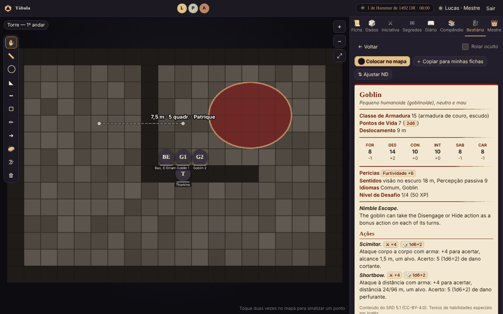

- As áreas e os desenhos ficam na cena até alguém apagar. Cada um apaga os seus; 👑 o mestre apaga qualquer um.
- Os tamanhos das áreas arredondam para quadrados inteiros, como no jogo de mesa.
- Dica: para mirar um cone ou uma linha, comece no seu token e arraste até o alvo.

### 🌫 Névoa de guerra (👑)

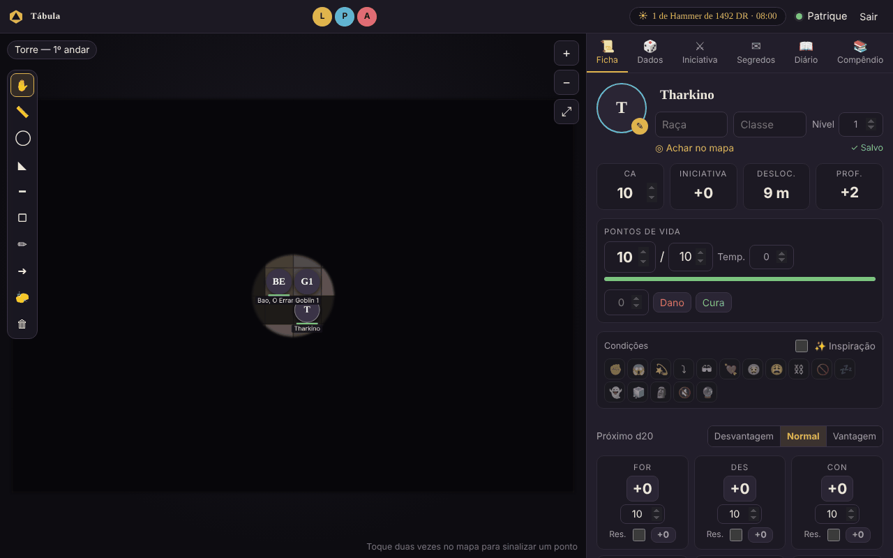

1. Clique em **🌫** na barra. Aparece a barra da névoa no topo do mapa.
2. Marque **Ligada**: o mapa inteiro fica coberto para os jogadores.
3. Escolha como revelar e **arraste no mapa**:
    - **▭ Revelar**: um retângulo (uma sala, um corredor);
    - **◯ Revelar**: um círculo (o alcance de uma tocha, o que se vê de um ponto);
    - **▭ Esconder**: cobre de novo um retângulo (o grupo saiu da sala e você quer escondê-la).
4. **↶** desfaz o último passo. **Cobrir tudo** recomeça do zero; **Revelar tudo** tira a névoa toda.

- Para você a névoa é **translúcida** (você continua vendo o mapa); para os jogadores ela é **escura**.
- **Monstros dentro da névoa nem chegam ao navegador dos jogadores**, então não dá para "espiar".
  Os personagens dos jogadores aparecem sempre.
- Desligar **Ligada** tira a névoa sem perder o que você revelou; ligar de novo volta como estava.

---

## Ficha

O jogador vê e edita só a ficha dele; 👑 o mestre vê e edita todas (os retratos no topo trocam de ficha).
Tudo **salva sozinho**: ao lado de "Achar no mapa" aparece **✓ Salvo**.

### Ficha em janela

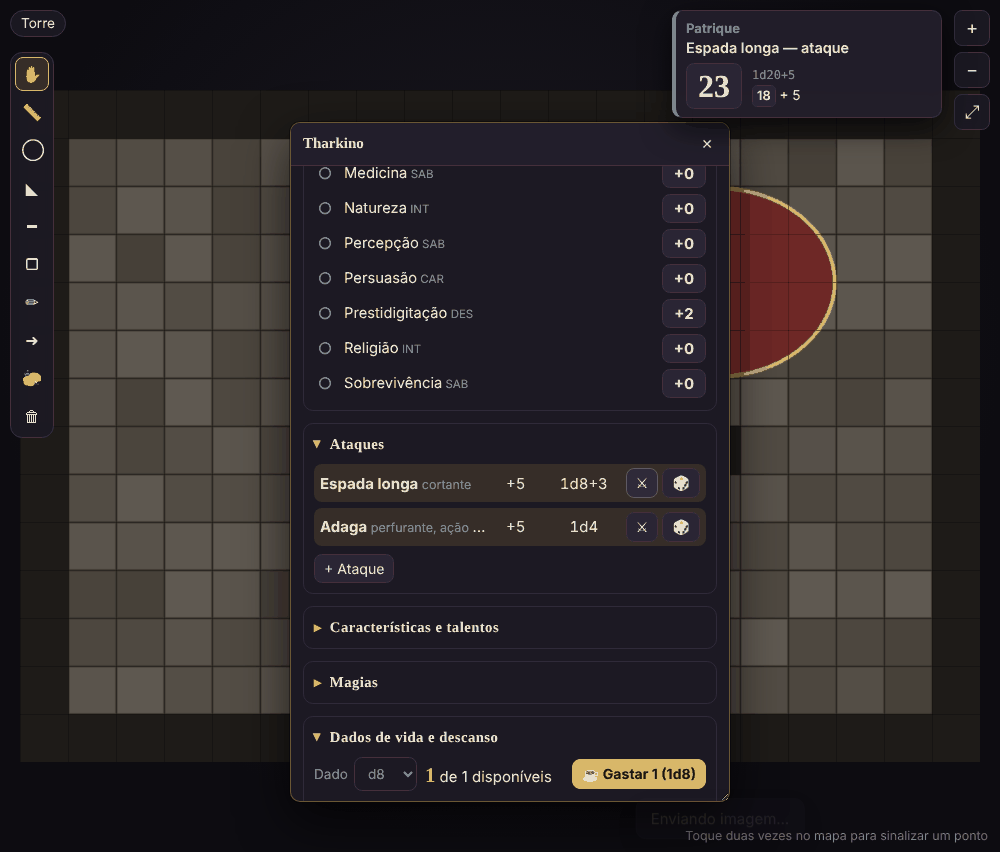

- **⧉ Em janela** (ao lado de "Achar no mapa"), ou **dois cliques no token**, abre a ficha numa janela por cima do mapa.
- **Arraste pelo título** para mover; **puxe o canto de baixo** para mudar o tamanho; **dois cliques no título**
  encolhem a janela só na barra; **✕** fecha. A posição e o tamanho ficam lembrados.
- 👑 O mestre pode abrir uma janela para cada jogador e deixar lado a lado. Também abre pelo **⧉** na lista de
  personagens (aba Mestre) ou por **📜 Ficha** no painel do token.
- **O grupo**: no topo da sua ficha ficam os retratos dos colegas. Clicar abre o equipamento deles, só para olhar.

  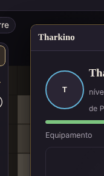
- No celular não há janelas: a ficha abre na aba **Ficha**, como sempre.

### Rolar dados pela ficha
- **Clique num número** para rolar: atributos, resistências (o quadradinho marca proficiência), perícias
  (○ sem proficiência, ● proficiente, ◉ especialista), iniciativa e ataques.
- **Próximo d20**: escolha **Vantagem** ou **Desvantagem** antes de clicar. Vale para a próxima rolagem de d20 e volta ao normal.

### Pontos de vida
Digite um número no campinho e clique **Dano** (gasta primeiro os PV temporários) ou **Cura**.
A barra muda de cor com metade da vida e quando chega a 0.

### Classe, dado de vida e PV por nível
- No campo **Classe**, escolha da lista (ou digite: "Guerreiro (Campeão)" também serve). A ficha já define o
  **dado de vida** da classe: d12 bárbaro; d10 guerreiro, paladino e patrulheiro; d8 bardo, bruxo, clérigo, druida,
  ladino, monge e artífice; d6 feiticeiro e mago. Classe inventada: escolha o dado à mão em *Dados de vida*.
- **❤ PV pela classe** (embaixo dos PV) liga o cálculo automático, como no Livro do Jogador:
  no **1º nível**, o máximo do dado + CON; **a cada nível seguinte**, a rolagem do dado (ou a **média fixa**,
  arredondada para cima: d6 4, d8 5, d10 6, d12 7) + CON. Cada nível dá pelo menos 1 PV.
- **Ao subir de nível** (mude o campo **Nível**), aparece **⬆ Nº nível: ganhe os PV** com **🎲 Rolar** e **Média**.
  A rolagem é feita pela mesa e aparece no chat para todos; os PV máximos e os atuais sobem juntos. Subiu vários
  níveis de uma vez? O quadro aparece para cada um.

  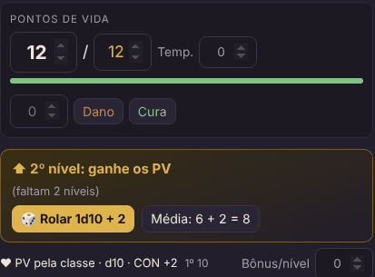
- Com o cálculo ligado, os **PV máximos ficam dourados** e não se digitam: eles seguem o nível, o dado e a CON.
  Se a CON subir, os PV sobem 1 por nível, como manda a regra.
- **Bônus/nível**: PV extras por nível, como o do anão da colina (+1) ou do talento Robusto (+2).
- 👑 O mestre escolhe a regra da mesa em **Mestre → Jogadores e personagens → Regras da mesa**: *o jogador escolhe*,
  *sempre rolar* ou *sempre a média*. Na ficha de cada personagem, o mestre pode **↶ desfazer** a última rolagem de PV
  ou **desligar** o cálculo e voltar aos PV digitados à mão.

### Multiclasse

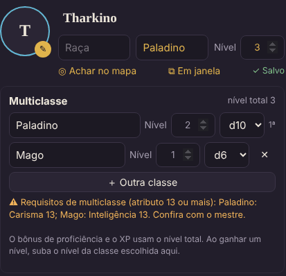

1. Na ficha, clique **＋ Multiclasse** (logo abaixo do nome). Aparece a lista de classes, com a atual em primeiro.
2. Escreva a nova classe (ou escolha da lista): o **dado de vida** dela se ajusta sozinho. Mude o **nível** de cada
   classe ali; **＋ Outra classe** acrescenta mais uma e **✕** tira uma (os níveis e os PV dela saem junto).
3. O cabeçalho passa a mostrar **"Paladino 2 / Mago 1"** e o **nível total** (que vale para o bônus de proficiência
   e para o XP). Classe e nível do cabeçalho ficam só de leitura: quem manda é a lista.

O que a ficha faz por você na multiclasse:
- **PV**: os do 1º nível vêm da **primeira classe** (a marcada **1ª**). Cada nível novo de qualquer classe usa o dado
  **daquela classe**: o quadro mostra "⬆ Mago 1: ganhe os PV" com **🎲 Rolar 1d6** ou a **média**.
- **Dados de vida**: um monte por tipo de dado (paladino 5 / clérigo 5 = cinco d10 e cinco d8), cada um com o seu
  botão **☕ Gastar 1**. O descanso longo devolve metade do total, começando pelos maiores.
- **Requisitos**: se faltar o atributo 13 que a regra pede (por exemplo, Inteligência 13 para mago), aparece um aviso.
  Ele não bloqueia nada, para o mestre poder liberar.
- **Espaços de magia**: em *Magias*, a ficha sugere os espaços pela **tabela de conjurador multiclasse** (classes
  completas somam o nível; paladino e patrulheiro, metade; cavaleiro arcano e trapaceiro arcano, um terço; artífice,
  metade para cima). **Usar esses** aplica. O bruxo aparece à parte, com a Magia de Pacto.
- A mesma sugestão de espaços funciona com uma classe só, pela tabela da própria classe.

### Condições, inspiração e testes contra a morte
- Toque nos ícones para marcar as condições; elas aparecem no seu token.
- **✨ Inspiração** quando o mestre der.
- Com **0 PV** aparece o quadro **☠ Testes contra a morte**. **🎲 Rolar** faz o teste e marca sozinho:
  10 ou mais é sucesso, menos de 10 é falha, **1 natural conta duas falhas** e **20 natural volta com 1 PV**.
  Três sucessos: estável. Três falhas: morte. **Zerar** limpa as marcas.

### Magias da ficha
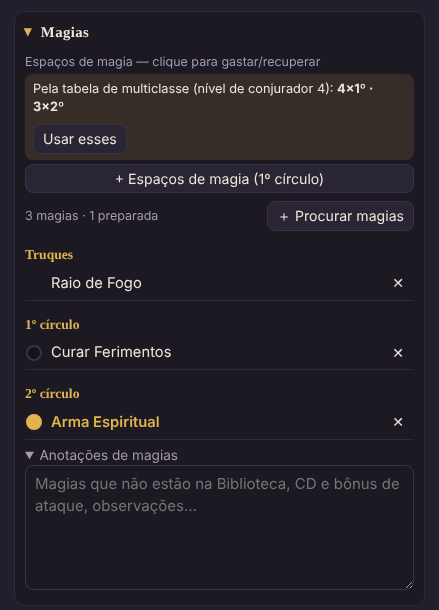

Dentro de **Magias**, abaixo dos espaços, fica a lista de magias do personagem, separada em **Truques**, **1º círculo**,
**2º círculo**… **＋ Procurar magias** abre a [Biblioteca](#biblioteca-magias-e-itens) já filtrada pelas suas
classes. Em cada magia:
- **toque no nome** para ver o cartão completo (tempo, alcance, componentes, duração, efeito, níveis superiores);
- **a bolinha** marca a magia como **preparada** (fica dourada; o resumo conta quantas estão preparadas);
- **✕** tira da ficha.

Magias que não estão na Biblioteca (de outros livros, ou inventadas pelo mestre) vão em **Anotações de magias**, logo
abaixo — é o mesmo campo de texto das versões antigas, então o que você já tinha escrito continua lá.

 

### Espaços de magia
Dentro de **Magias**: **+ Espaços de magia** cria os do 1º círculo; **+ Espaço de 2º círculo** e assim por diante.
Em cada círculo, **+** e **−** mudam quantos você tem; **toque nas bolinhas** para gastar e recuperar.
O descanso longo recupera todos. Para conjuradores, a ficha sugere os espaços pela tabela da classe (ou da
multiclasse): **Usar esses** aplica.

### Dados de vida e descanso curto
O **dado** vem da classe (dá para trocar à mão, para classes inventadas). No descanso curto, **☕ Gastar 1** rola o
dado + CON e a cura entra direto nos PV. Você tem tantos dados quanto o seu nível; o descanso longo devolve metade.
Na multiclasse, cada tipo de dado tem o seu monte (veja [Multiclasse](#multiclasse)).

### Experiência e moedas
Digite o **XP**; a barra mostra quanto falta para o próximo nível e aparece um aviso quando já dá para subir.
As moedas são PC (cobre), PP (prata), PE (electrum), PO (ouro) e PL (platina).

### Aspecto mágico e anel
Dois quadros logo abaixo dos PV. 👑 Só o mestre escreve: o mês de nascimento, o nome, o efeito do nível 1 ao 4 e o
efeito a partir do nível 5. O jogador lê na ficha; quando o personagem chega ao nível 5, a versão melhorada
aparece no lugar.

### Colar imagem (Ctrl+V)
Copie uma imagem (do navegador, de um print) e aperte **Ctrl+V** com a ficha aberta: ela vira o retrato e o token.
O mesmo vale numa janela de ficha (clique nela antes), no editor de item e nas fichas do bestiário.

---

## Equipamento e mochila

Na ficha, em **Equipamento e mochila**: o boneco com os espaços do corpo, um resumo (CA, sintonia, carga)
e a mochila embaixo.

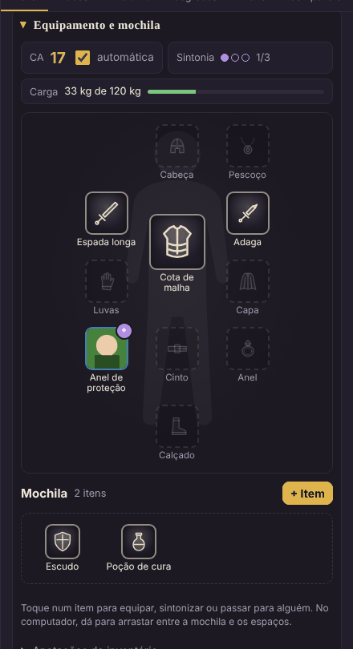

### Criar um item

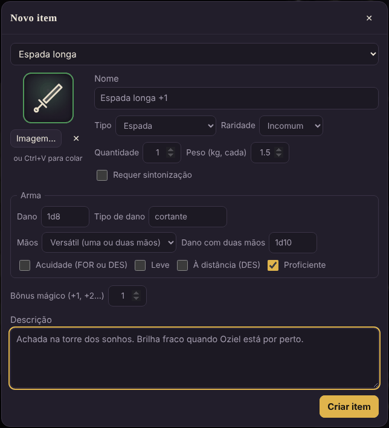

1. **+ Item** (embaixo do boneco).
2. **Modelo** (opcional): escolha uma arma, armadura ou equipamento do Livro do Jogador. Os campos se preenchem
   (dano, propriedades, CA, peso). Depois mude o que quiser, como o nome ("Espada longa +1").
3. Confira **tipo**, **raridade**, **quantidade**, **peso** e se **requer sintonização**.
4. Para armas: **dano**, **tipo de dano**, **mãos** (uma, duas ou versátil, com o dano de duas mãos),
   **acuidade**, **leve**, **à distância** e **proficiente**.
   Para armaduras: o tipo (leve, média, pesada) e a CA base. Para escudos: o bônus de CA (+2).
5. **Bônus mágico** (+1, +2…): nas armas soma no ataque e no dano; em armaduras e escudos, na CA.
   **Bônus na CA** serve para anéis, mantos e outros itens que dão CA (Anel de Proteção +1).
6. **Descrição**: o que o item faz, cargas, de onde veio.
7. **Criar item**.

**A imagem**: cada tipo de item tem um desenho próprio (espada, arco, cajado, escudo, elmo, anel, poção…) e a borda
tem a cor da raridade: cinza (comum), verde (incomum), azul (raro), roxo (muito raro), laranja (lendário),
vermelho (artefato). Para pôr a arte final, use **Imagem…** ou cole com **Ctrl+V** no editor; **✕** volta ao desenho.

### Usar um item

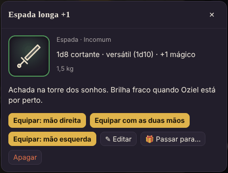

**Toque num item** (na mochila ou no boneco) para ver os detalhes e escolher:

- **Equipar**: o item vai para o espaço certo. Armas perguntam a mão; armas versáteis oferecem
  **com as duas mãos**; anéis vão no espaço de anel livre.
- **↩ Guardar na mochila**: tira do corpo.
- **🙌 Usar com as duas mãos / ✋ com uma mão** (arma versátil na mão direita).
- **✦ Sintonizar / ✧ Desfazer a sintonia** (itens que exigem sintonia).
- **✎ Editar**, **Separar 1** (de uma pilha, ex.: uma das 3 poções), **🎁 Passar para…** e **Apagar**.

Também dá para **tocar num espaço vazio** do boneco: aparece a lista dos itens da mochila que servem ali.
No computador, **arraste** itens da mochila para os espaços, de um espaço para outro, ou de volta para a mochila.

### Regras que a ficha cuida para você
- **Duas mãos**: uma arma de duas mãos ocupa as duas; a mão esquerda aparece bloqueada. Equipar algo na mão
  esquerda tira a arma de duas mãos (ou, se for versátil, faz ela voltar a uma mão).
- **Sintonia**: no máximo **3 itens** sintonizados (as bolinhas roxas no resumo). Item que exige sintonia só dá o
  bônus mágico quando está sintonizado.
- **CA automática**: com armadura, escudo ou um item que dá CA equipado, a CA da ficha se calcula sozinha e fica
  dourada. Armadura **leve** soma a DES; **média** soma a DES até +2; **pesada** não soma. Escudo +2.
  Sem nada disso equipado, vale a CA que você digitou. Se a sua classe calcula diferente (bárbaro, monge),
  desmarque **automática** no resumo e digite a CA.
- **Ataques**: as armas equipadas aparecem em **Ataques** com o bônus (atributo + proficiência + mágico) e o dano
  já calculados: armas à distância usam DES, com acuidade usam o maior entre FOR e DES. A arma da mão esquerda,
  com outra na direita, é o ataque da **ação bônus** e não soma o modificador ao dano. Para mudar, edite o item.
- **Carga**: soma o peso de tudo contra a sua capacidade, **7,5 × Força** em kg. A barra fica vermelha se passar.

### Dar e trocar itens
- 👑 Na ficha de um jogador, o botão vira **🎁 Dar item**: o item é criado direto na mochila dele, e ele recebe um aviso.
- Jogadores trocam itens com **🎁 Passar para…**: escolha o personagem e quantos. O item chega desequipado e o
  dono recebe um aviso.
- Os colegas veem o que você tem **equipado**, nunca a sua mochila.
- O que não cabe como item (dívidas, coisas guardadas na estalagem) vai em **Anotações do inventário**.

---

## Dados

- Os **botões d4 a d100** rolam um dado. O d20 respeita a vantagem/desvantagem escolhida.
- Ou digite no campo de mensagem e aperte **Enviar**:

  | Você digita | O que acontece |
  |---|---|
  | `1d20+5` | rola 1d20 e soma 5 |
  | `2d6+1d4-1` | soma vários dados |
  | `2d20kh1` / `2d20kl1` | vantagem / desvantagem (fica com o maior / menor) |
  | `4d6kh3` | 4d6 e fica com os 3 maiores (criar atributos) |
  | `d%` | 1d100 |
  | `/r 1d8+3 espada` | rola e põe um nome na rolagem |
  | qualquer outro texto | vira mensagem no chat |

- **Rolagem secreta**: só você e o mestre veem. 👑 Para o mestre, **rolagem oculta**: só ele vê.
- Toda rolagem aparece num **cartão ao lado do painel**, para todos que podem vê-la. Desligue em **Rolagens na tela**.
- Os dados são rolados no servidor, então ninguém consegue "escolher" o resultado.

---

## Iniciativa

1. Os jogadores clicam **🎲 Rolar minha iniciativa** (usa a DES e o bônus extra da ficha).
2. 👑 **+ Todos os tokens da cena** rola para quem ainda não está na lista (monstros ocultos continuam ocultos).
   Dá para editar o valor de cada um direto na lista.
3. 👑 **⚔ Começar combate**. A ordem aparece no topo do mapa para todos, com a vez destacada.
4. A cada turno, **Próximo ▶** (o mestre) ou **Terminei meu turno ➜** (o jogador da vez). **◀ Anterior** volta.
5. 👑 **Encerrar** limpa a lista.

---

## Segredos e fila de memórias

Para memórias, pistas, cartas e mapas do tesouro que só um jogador deve ver.

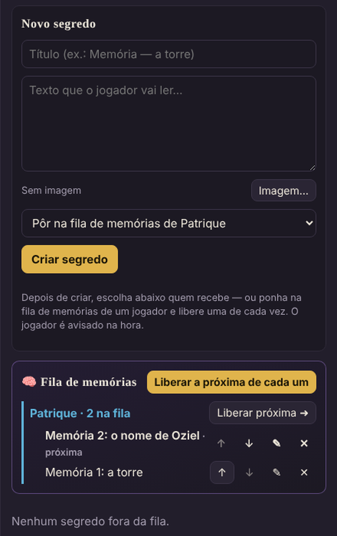

- 👑 **Novo segredo**: título, texto e imagem (opcional) → **Criar segredo**. Depois escolha quem vê: **Todos** ou
  jogadores específicos. Quem recebe é avisado na hora; os outros não veem nada.
- 👑 **Fila de memórias**: ao criar, escolha *Pôr na fila de memórias de…*. Na caixa **🧠 Fila de memórias**,
  reordene com **↑ ↓** e, na hora certa, clique **Liberar próxima ➜**: só a primeira da fila chega ao jogador.
  **Liberar a próxima de cada um** faz isso para todos ao mesmo tempo. **✕** tira da fila sem apagar.
- O jogador vê os segredos dele na aba **✉ Segredos** (o número na aba avisa quando chega um novo).

---

## Diário e compêndio

- **📖 Diário do grupo**: todos escrevem (pistas, nomes, dívidas, piadas internas). Cada um edita e apaga o que é seu;
  👑 o mestre pode apagar qualquer entrada. O número na aba mostra o que os outros escreveram desde a sua última visita.
- **📚 Compêndio → 📄 Páginas**: 👑 páginas de consulta do mestre, com título, categoria, texto e imagens (dá para
  pôr o print de uma tabela). **🔒 Só eu (mestre)** para as suas notas; **👁 Todos os jogadores** para liberar. Os
  jogadores leem e buscam as páginas liberadas. É aqui que entra a lore do seu mundo.
- **📚 Compêndio → ✨ Magias / 🎒 Itens**: a [Biblioteca](#biblioteca-magias-e-itens).

---

## Biblioteca: magias e itens

No **📚 Compêndio**, as abas **✨ Magias** e **🎒 Itens** trazem o conteúdo do *SRD 5.1* (a parte das regras que a
Wizards liberou com licença aberta) traduzido para o português, com os nomes do Livro do Jogador. A aba **📄 Páginas**
continua sendo o lugar das páginas do mestre (lore, regras da casa, NPCs).

### Magias
- **Para**: escolha o personagem (o jogador já vem com o dele). Com **Só as que pode conjurar** marcado, a lista mostra
  só as magias das listas das classes da ficha, até o círculo que cada classe já alcança — **na multiclasse, cada
  classe conta com o próprio nível** (um Clérigo 3 / Mago 1 vê clérigo até o 2º círculo e mago até o 1º). Cavaleiro
  arcano e trapaceiro arcano usam a lista do mago; o bruxo mostra a Arcana Mística (6º a 9º) a partir do nível 11.
  A frase em cinza abaixo dos filtros diz exatamente o que está sendo considerado.
- Busque pelo nome em português **ou em inglês**; filtre por círculo (**Truques**, **1º**…), por classe, por escola,
  e só rituais ou só concentração. **C** e **R** na linha marcam concentração e ritual.
- Toque na magia para abrir o cartão e clique **＋ Adicionar à ficha de …**. O **✓** marca as que já estão na ficha.
  Magias fora das listas da ficha também podem ser adicionadas (um talento, um item, uma decisão do mestre); o cartão
  avisa que estão fora.
- 👑 O mestre escolhe qualquer personagem em **Para**, ou **— só consultar —** para ler sem filtro.

As 319 magias do SRD estão lá. Magias de outros livros (Xanathar, Tasha…) não fazem parte do SRD; escreva-as em
**Anotações de magias** na ficha. O artífice não está no SRD; a lista dele foi montada com as magias do SRD que ele
aprende no *Caldeirão de Tasha para Tudo*.

### Itens
- Categorias: **Armas**, **Armaduras**, **Equipamento**, **Ferramentas**, **Pacotes** e **Montarias e veículos**, com
  preço, peso e, nas armas e armaduras, dano, propriedades e CA.
- **＋ Pôr na mochila de …** cria o item na ficha já preenchido: a arma entra pronta para o ataque automático, a
  armadura e o escudo entram na CA automática quando equipados. Escolha a **Qtd.** antes; itens iguais que não vão no
  corpo (tochas, rações, flechas) juntam na mesma pilha.
- **Pacotes** (de aventureiro, explorador…) põem o **conteúdo** na mochila, item por item.
- **Montarias e veículos** viram uma posse que **não conta no peso** carregado.
- O jogador só põe itens nos próprios personagens; 👑 o mestre põe em qualquer um, e o dono recebe o aviso 🎁.

### Itens mágicos (👑)
Só o mestre vê o botão **✨ Itens mágicos 🔒**. Filtre pela raridade, escolha o personagem em **Para** e clique
**🎁 Dar a …**. Itens que servem em qualquer arma ou armadura (*Arma +1*, *Língua flamejante*, *Armadura +2*…) pedem a
**Base** (cimitarra, cota de malha…) e já entram com o dano, a CA e o bônus mágico certos; a sintonização também vem
marcada. Os nomes estão em português (os do Livro do Mestre); **a descrição ainda está no original em inglês do SRD** —
dá para trocar pelo texto do livro editando o item depois de dar.

---

## Calendário e descansos (👑)

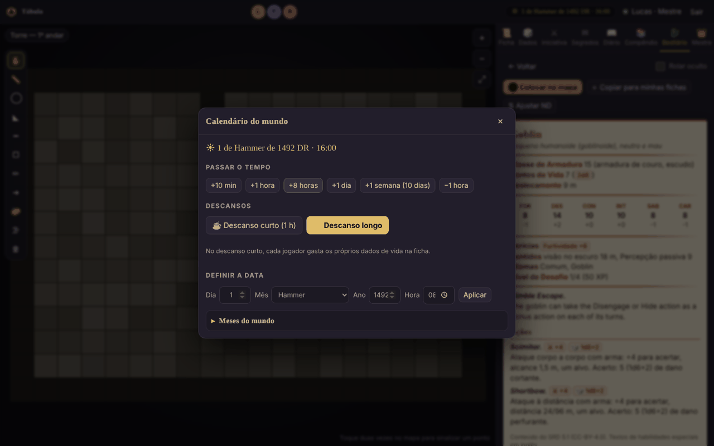

A data e a hora do mundo ficam no topo da tela, para todos. 👑 Clique nelas para:

- **Passar o tempo**: +10 min, +1 hora, +8 horas, +1 dia, +1 semana (dez dias, como em Faerûn), −1 hora.
- **☕ Descanso curto**: passa 1 hora e avisa no chat; cada jogador gasta os dados de vida na própria ficha.
- **🌙 Descanso longo**: passa 8 horas e, para os personagens dos jogadores, enche os PV, recupera os espaços de
  magia, devolve metade dos dados de vida e zera os testes contra a morte.
- **Definir a data**: dia, mês, ano e hora → **Aplicar**.
- **Meses do mundo**: um por linha, `Nome | dias` (e `| festival` para os dias festivos). O padrão é o calendário de
  Harptos, com a era DR; troque pelos meses do seu mundo e **Salvar meses**.

---

## Bestiário (👑)

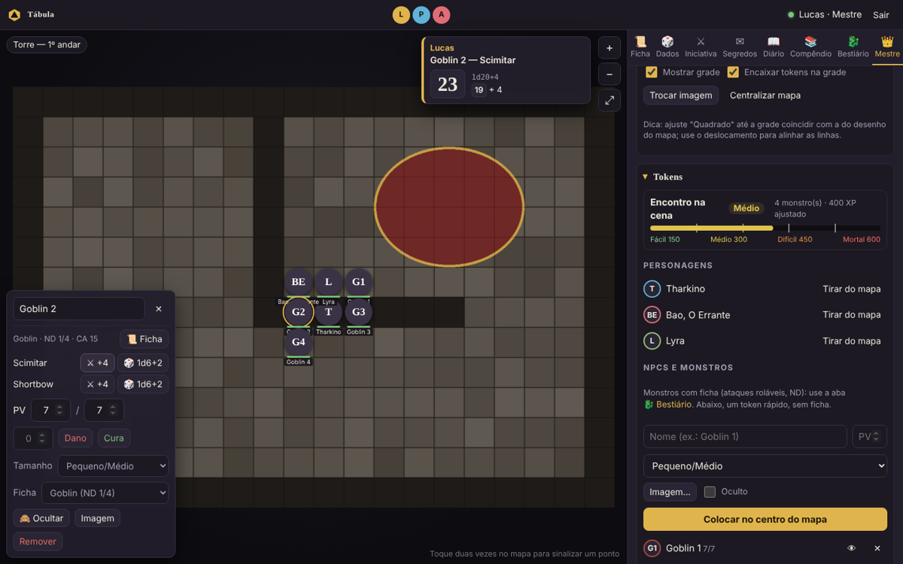

- **Biblioteca SRD**: 334 monstros prontos. Busque em português ou inglês, ou filtre por ND. Abra um e escolha
  **⬤ Colocar no mapa** ou **+ Copiar para minhas fichas** (para editar antes).
- **+ Nova ficha**: crie um NPC ou monstro do zero. Preencha **Atq** e **Dano** nas ações para ganhar botões de rolar.
- **⬤ Colocar no mapa**: quantos, PV (média ou rolados para cada um) e se ficam ocultos. Os tokens ganham número
  (Goblin 1, Goblin 2…) e o tamanho certo; a janela mostra a dificuldade do encontro.
- **⇅ Ajustar ND**: escolha o ND novo e compare lado a lado. **Salvar como nova ficha** cria uma variante sem mexer
  no original.
- **Dificuldade do encontro**: fácil, médio, difícil ou mortal, pelos limites de XP do Livro do Mestre, no painel
  do mestre e ao colocar monstros.
- **🖼 Imagens em lote**: escolha várias imagens de uma vez; o **nome do arquivo** diz de qual monstro é
  (`goblin.png`, `Lobo.jpg`, `adult-red-dragon.webp`). Para uma ficha só, cole com **Ctrl+V**.
- **Painel do token**: clique num token de monstro para ver a ficha, rolar os ataques, aplicar dano e cura e marcar condições.

---

## Painel do mestre (👑)

Aba **👑 Mestre**:

- **Jogadores e personagens**: crie a conta de cada jogador (nome e senha) já com o personagem; troque o dono de um
  personagem; **🔑** troca a senha; **Ficha** e **⧉** abrem a ficha. O papel **Telão (só assiste)** serve para uma
  TV no jogo presencial.
- **Cenas (mapas)**: dê um nome, informe **Quadrados na largura do mapa** (quantos quadrados o desenho tem na
  horizontal) e **Escolher imagem e criar**. **Mostrar** põe a cena para o grupo ver (ela fica marcada **No ar**).
- **Cena ativa (grade)**: ajuste os quadrados, o deslocamento da grade, mostrar a grade e encaixar os tokens.
- **Tokens**: coloque e tire os personagens do mapa; crie NPCs simples (nome, PV, tamanho, imagem); **Oculto** prepara
  uma emboscada (o token fica semitransparente para você e invisível para os jogadores).
- **Sessão e backups**: **💾 Criar ponto agora**, a lista de pontos salvos (automáticos a cada 30 minutos, na abertura
  e no fim da sessão), **Restaurar**, **⬇ Baixar** e **📂 Carregar arquivo…**. No fim, **⏻ Salvar e encerrar a sessão**
  salva tudo e avisa os jogadores.

---

## Atalhos de teclado

Fora de campos de texto:

| Tecla | Faz |
|---|---|
| **R** ou **M** | régua |
| **C** | círculo (esfera) |
| **D** | desenho livre |
| **Esc** | volta para ✋ Mover (e fecha janelas de diálogo) |
| **Setas** | andam um quadrado com o token selecionado |
| **Ctrl+V** | cola uma imagem na ficha, na janela de ficha, no item ou na ficha do bestiário abertos |
