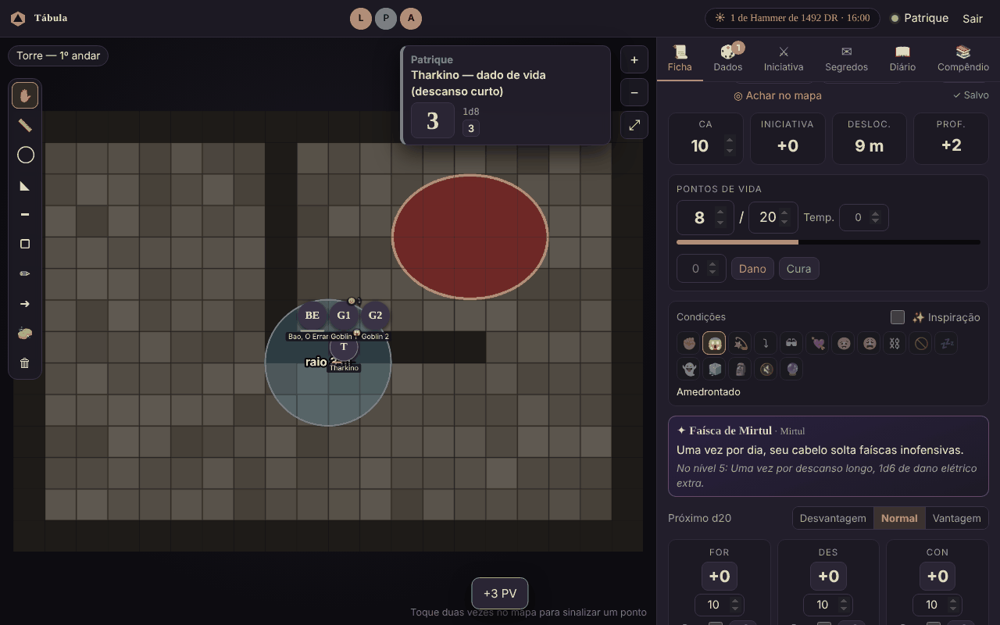

# Guia do jogador

Bem-vindo à mesa! Não precisa instalar nada: só o navegador (PC ou celular).

## Entrar

1. Abra o link que o mestre mandou. **Ele muda a cada sessão.**
2. Escolha seu nome na lista e digite a senha que o mestre te passou.

No celular, as abas ficam embaixo: **Mapa · Ficha · Dados · Iniciativa · Segredos · Diário · Compêndio**.

## Mapa

- **Arraste o seu token** para andar. Ele encaixa na grade. Você só move o seu.
- **Arrastar o fundo** move a visão; **rodinha do mouse** ou **pinça com dois dedos** dá zoom; ⤢ ajusta à tela.
- **Dois cliques ou dois toques** no mapa mostram um sinal para todo mundo ("olha aqui!").
- Na Ficha, **◎ Achar no mapa** centraliza no seu token.
- **Ferramentas** (barra à esquerda do mapa): 📏 régua para medir a distância (cada quadrado é 1,5 m;
  todos veem enquanto você mede), ◯ ◣ ━ ▢ áreas de magia (esfera, cone, linha, cubo), ✏ desenho livre,
  ➜ seta, 🧽 borracha para apagar os seus desenhos. Volte para ✋ para andar com o token.
- Partes escuras do mapa são **névoa**: o mestre revela quando vocês chegarem lá.
- O **relógio no topo** mostra o dia e a hora no mundo do jogo.

## Ficha

- Tudo salva sozinho: aparece **"✓ Salvo"** ao lado de "Achar no mapa".
- **Clique no retrato** para trocar a foto. Ela também vira o seu token.
- **Clique num número** para rolar: atributos, resistências (o quadradinho marca proficiência),
  perícias (○ sem proficiência, ● proficiente, ◉ especialista), iniciativa, ataques e dano.
- **Vantagem/Desvantagem**: escolha antes de clicar. Vale para a próxima rolagem de d20 e depois volta ao normal.
- **PV**: digite um número e clique em **Dano** (gasta primeiro os PV temporários) ou **Cura**.
- **Imagem nova**: além de clicar no retrato, dá para copiar uma imagem e apertar **Ctrl+V** com a ficha aberta.
- **Condições**: toque nos ícones (envenenado, caído, amedrontado…). Elas aparecem no seu token.
  Marque **✨ Inspiração** quando o mestre der.
- **Testes contra a morte**: com 0 PV aparece o quadro ☠. **🎲 Rolar** faz o teste e marca sozinho
  (20 natural volta com 1 PV; 1 natural conta duas falhas).
- **Espaços de magia** (dentro de *Magias*): crie os espaços de cada círculo com **+** e toque nas bolinhas para gastar.
- **Dados de vida**: no descanso curto, **☕ Gastar 1** rola o dado + CON e cura na hora.
  No descanso longo o mestre recupera PV, espaços e metade dos dados de vida de todo mundo.
- **XP e moedas**: em *Experiência e moedas*. Quando o XP passar do próximo nível, aparece um aviso.
- **Aspecto mágico e anel**: se o mestre tiver definido, aparecem embaixo dos PV.

## Dados

- Botões rápidos: d4, d6, d8, d10, d12, d20, d100.
- Ou digite: `1d20+5`, `2d6+3`, `1d8+1d6+2`, `4d6kh3` (4d6 ficando com os 3 maiores).
- Com nome: `/r 1d8+3 machado`.
- **Rolagem secreta**: só você e o mestre veem.
- 20 natural fica verde; 1 natural, vermelho.
- Toda rolagem (sua, dos outros e do mestre) aparece num **cartão ao lado do mapa** por alguns segundos.
  Para desligar: *Dados → Rolagens na tela*.

## Iniciativa

Quando o mestre pedir, clique em **🎲 Rolar minha iniciativa**. Na sua vez aparece
**"É a sua vez!"**, e você pode clicar em **Terminei meu turno ➜**.

## Segredos

Coisas que **só você** recebeu do mestre: memórias, pistas, cartas. Os outros jogadores não veem.
Quando chega um novo, aparece um aviso na tela.

## Diário do grupo

Anotem o que aconteceu, nomes de NPCs, pistas, dívidas… Todo mundo lê. Você só edita e apaga o que você escreveu.

## Compêndio

Material de consulta que o mestre liberou (tabelas de XP, preços, regras da casa). Use a busca e
toque nas imagens para ampliar.
