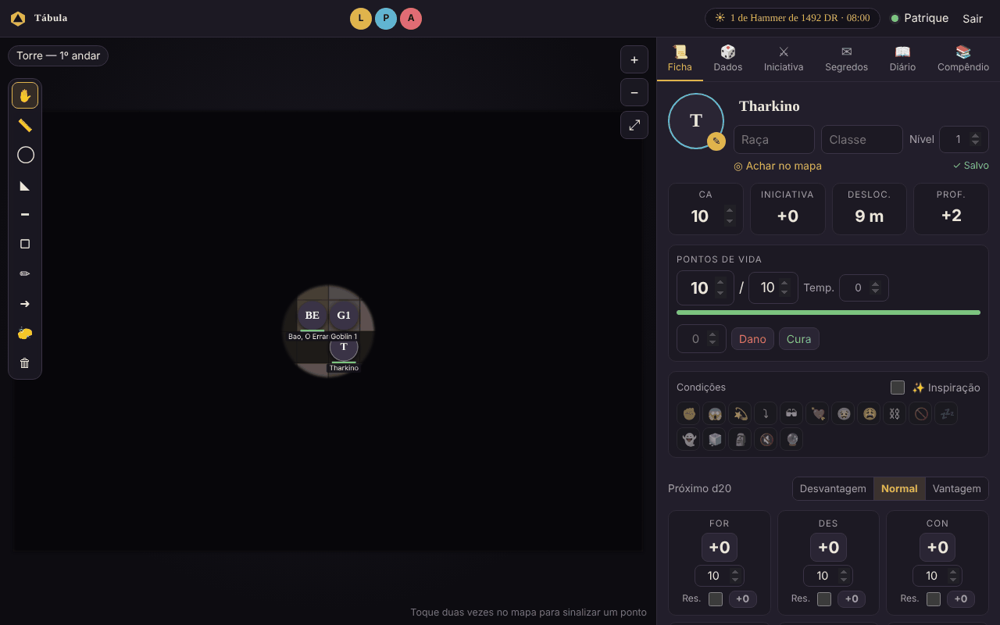
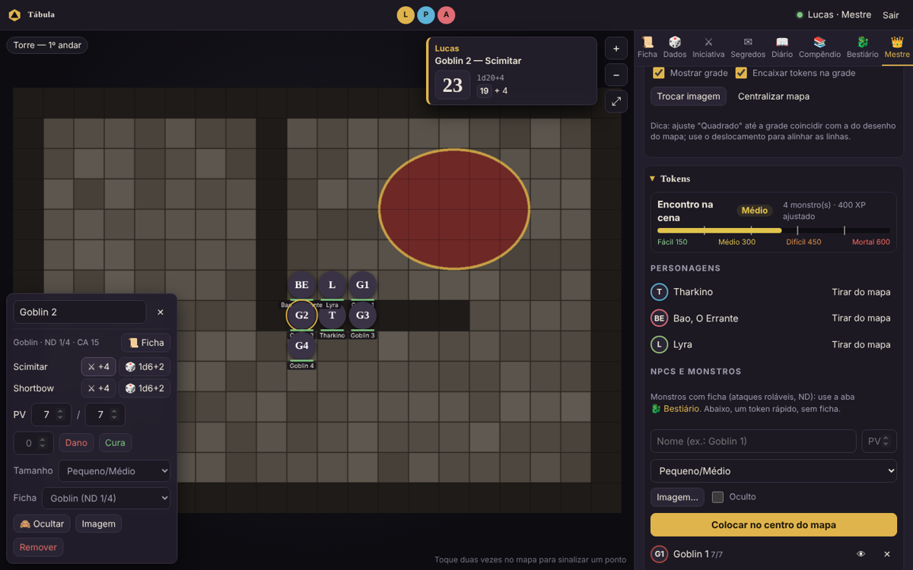
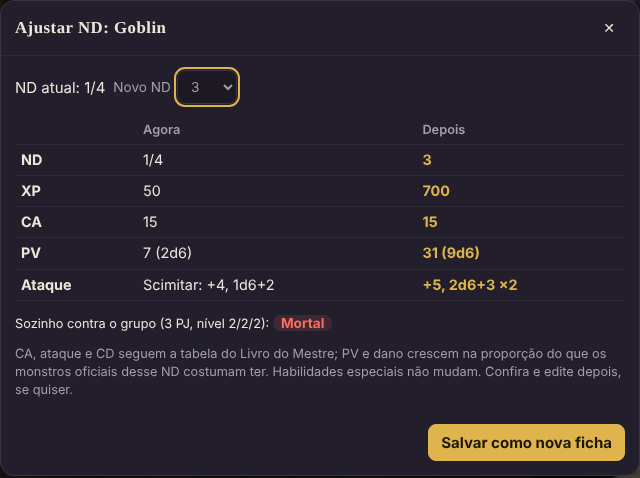
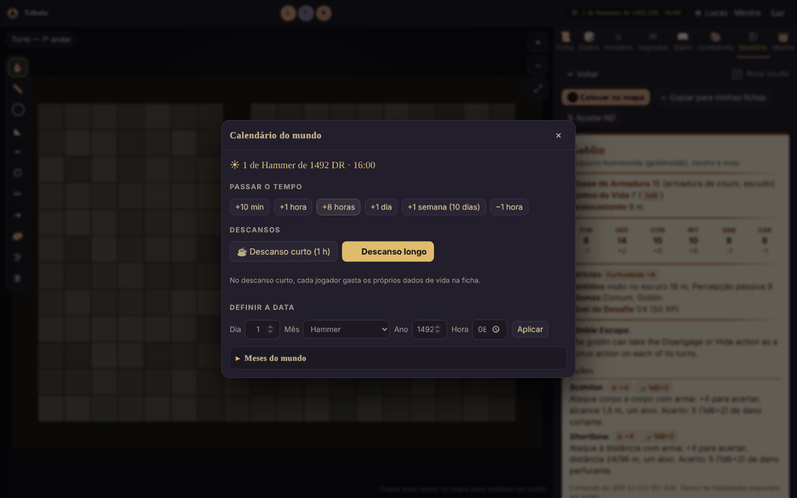

# Guia do mestre

Tudo que é exclusivo do mestre fica na aba **👑 Mestre**, além das ferramentas de edição nas outras abas.

## Antes da primeira sessão

### Criar os jogadores
**Mestre → Jogadores e personagens → Usuários**

1. Preencha **nome** e **senha** do jogador.
2. Deixe **"Já criar personagem"** marcado e escreva o nome do personagem: a ficha já nasce vinculada a ele.
3. Mande o link da mesa, o nome e a senha para cada jogador (a senha, de preferência, no privado).

Papéis possíveis:
- **Jogador**: vê e edita só o próprio personagem, move só o próprio token.
- **Telão (só assiste)**: vê só o mapa e a iniciativa, sem nenhuma aba. Para uma TV no presencial.

Para trocar a senha de alguém, use o 🔑 ao lado do nome. Para trocar o dono de um personagem, use o
menu ao lado dele em **Personagens**.

### Criar uma cena (mapa)
**Mestre → Cenas (mapas)**

1. Dê um nome à cena.
2. Em **Quadrados na largura do mapa**, conte quantos quadrados o desenho tem de uma borda à outra, na horizontal. Isso faz o token ter o tamanho de um quadrado.
3. Clique em **Escolher imagem e criar** (PNG, JPG, WEBP ou GIF, até 25 MB).

A primeira cena já vai ao ar. Para trocar o que os jogadores veem, clique em **Mostrar** em outra cena.

### Acertar a grade
**Mestre → Cena ativa (grade)**

- **Quadrados na largura**: o jeito mais fácil; a mesa calcula o tamanho do quadrado.
- **Quadrado (px)**: ajuste fino.
- **Desloc. X / Y**: empurra a grade até as linhas coincidirem com as do desenho.
- **Mostrar grade** e **Encaixar tokens na grade** podem ser desligados para mapas sem grade.

> Se um token parecer minúsculo ou "não aparecer", quase sempre é a grade com o tamanho errado.

## Tokens

**Mestre → Tokens**

- **Personagens**: **Colocar no mapa** / **Tirar do mapa**. A foto do token é a foto da ficha.
- **NPCs e monstros**: nome, PV, tamanho e imagem (opcional). Se o nome terminar em número
  (`Goblin 1`), o próximo já vem como `Goblin 2`.
- Marque **Oculto** para preparar uma emboscada: o token fica semitransparente para você e invisível para os jogadores.

O token novo aparece **no centro da tela**, num quadrado livre, e pisca para você achar.

**Clicar num token** abre um painel no canto do mapa: nome, tamanho, PV do NPC, imagem,
ocultar/revelar e remover. Com o token selecionado, as **setas do teclado** andam um quadrado.

Os jogadores veem a barra de vida dos personagens, mas não a dos monstros: só um **aro vermelho**
quando o monstro está com metade da vida ou menos, e o token **cinza com ✖** quando ele cai.

**Condições**: no painel do token, clique nos ícones (envenenado 🤢, caído ⤵, amedrontado 😱,
concentração 🔮…). Elas aparecem no token para todos. Num personagem, a condição vai também para a ficha dele.

## Ferramentas do mapa

A barra à esquerda do mapa (todos têm, menos a névoa):

| | |
|---|---|
| ✋ | Mover e selecionar (Esc volta para ela) |
| 📏 | Régua: arraste para medir. Diagonal conta como um quadrado (1,5 m). Todos veem a régua de quem está medindo |
| ◯ ◣ ━ ▢ | Áreas de magia: esfera (arraste do centro até a borda), cone, linha e cubo. A medida aparece escrita |
| ✏ ➜ | Desenho livre e seta |
| 🧽 | Borracha: toque num desenho. Cada jogador apaga os seus; você apaga qualquer um |
| 🗑 | Limpar: você apaga todos os desenhos da cena; o jogador, só os dele |

Atalhos: **R** régua, **C** círculo, **D** desenho, **Esc** mover.

### Névoa de guerra

1. Clique em **🌫** e marque **Ligada**: o mapa inteiro fica coberto para os jogadores.
2. Escolha **▭ Revelar** ou **◯ Revelar** e arraste no mapa sobre o que o grupo está vendo.
3. **▭ Esconder** cobre de novo; **↶** desfaz o último; **Cobrir tudo** e **Revelar tudo** fazem o óbvio.

Para você a névoa é translúcida, para continuar vendo o mapa. Para os jogadores ela é escura, e os
**monstros que estão na névoa nem são enviados** para o navegador deles (não dá para "espiar").
Os personagens dos jogadores aparecem sempre.

## Bestiário (fichas de NPCs e monstros)

Aba **🐉 Bestiário**, só sua. As fichas ficam salvas na campanha.

### Pegar um monstro pronto
1. **Biblioteca SRD** → busque (em português ou inglês) ou filtre por ND.
2. Abra o monstro e escolha **Colocar no mapa** (ele é copiado para *Minhas fichas* automaticamente)
   ou **Copiar para minhas fichas** para editar antes.

Os 334 monstros do SRD 5.1 têm os nomes dos mais comuns e o texto dos ataques em português;
habilidades especiais estão em inglês. Você pode editar qualquer cópia.

### Criar uma ficha do zero
**+ Nova ficha** → nome, ND, tamanho, CA, PV, atributos e ações. Preencha **Atq** (bônus de ataque) e
**Dano** (ex.: `1d8+3`) para o ataque ganhar botões de rolar. A imagem da ficha vira o token.

### Colocar no mapa
Na ficha: **⬤ Colocar no mapa** → quantos, PV (média ou rolar para cada um) e se ficam ocultos.
A janela já mostra como fica a **dificuldade do encontro** com eles. Os tokens recebem números
(`Goblin 1`, `Goblin 2`…) e o tamanho certo (Grande = 2×2, Enorme = 3×3…).

### Ajustar o ND (deixar mais forte ou mais fraco)
Na ficha: **⇅ Ajustar ND** → escolha o novo ND e veja a comparação lado a lado. **Salvar como nova
ficha** cria uma variante (`Goblin (ND 3)`) sem mexer no original.

- **CA, bônus de ataque e CD** mudam conforme a tabela *Estatísticas de Monstro por Nível de Desafio* do Livro do Mestre.
- **PV e dano** crescem na proporção do que os monstros oficiais daquele ND costumam ter. A tabela
  do livro é bem mais alta que os monstros reais nos ND baixos (um goblin ND 1/4 "deveria" ter ~42 PV),
  então usar ela direto deixaria tudo uma esponja de dano.
- Se um monstro de um ataque só fica muito mais forte, ele ganha **Ataques Múltiplos** em vez de um golpe gigante.
- Habilidades especiais não mudam. Confira a ficha e ajuste à mão o que quiser.

> Dica de equilíbrio: em vez de subir muito o ND de um monstro, costuma ser mais divertido subir um
> pouco e colocar mais criaturas. Fique de olho no medidor de dificuldade.

### Dificuldade do encontro
Em **Mestre → Tokens** (e ao colocar monstros) aparece **Fácil / Médio / Difícil / Mortal**, calculado
como no capítulo 3 do Livro do Mestre: limites de XP pelo nível de cada personagem dos jogadores,
XP dos monstros vivos na cena e o multiplicador pela quantidade de monstros. Tokens sem ficha não entram na conta.

### Imagens de muitas fichas de uma vez
**🖼 Imagens em lote** → escolha várias imagens. O **nome do arquivo** diz de qual monstro é:
`goblin.png`, `Lobo.jpg`, `Dragão Vermelho Adulto.webp` ou o código do SRD (`adult-red-dragon.png`).
Antes de aplicar, a janela mostra quem recebe cada imagem e quais arquivos não acharam ficha.
Se o monstro só existe na Biblioteca SRD, ele vira uma ficha sua, já com a imagem.

Para uma ficha só: abra a ficha (ou o editor) e **cole a imagem com Ctrl+V**. Os tokens daquela ficha
que já estão no mapa trocam de imagem junto.

### Token de NPC no mapa
Clique no token: o painel mostra a ficha (**📜 Ficha**), os ataques com botões de rolar, PV com
**Dano/Cura**, tamanho, a ficha vinculada (dá para vincular um token antigo a uma ficha), ocultar e remover.
Para rolar sem os jogadores verem, marque **Rolar oculto** na ficha (ou *Rolagem oculta* na aba Dados).

## Durante o jogo

- **Sinalizar**: dois cliques no mapa mostram um círculo para todos.
- **Rolagem oculta**: na aba Dados, marque "Rolagem oculta". Só você vê o resultado.
- **Pop-up das rolagens**: toda rolagem aparece num cartão ao lado do painel, para todos. Desligue em *Dados → Rolagens na tela* se incomodar.
- **Fichas**: na aba Ficha, a fileira de retratos no topo troca de personagem. Tudo salva sozinho ("✓ Salvo").

### Iniciativa
1. Peça aos jogadores para clicarem em **Rolar minha iniciativa**.
2. Clique em **+ Todos os tokens da cena**: rola para quem ainda não está na lista (monstros ocultos ficam ocultos).
3. **⚔ Começar combate**, depois **Próximo ▶** a cada turno. O jogador da vez também pode passar o turno.
4. O valor de cada um pode ser editado direto na lista. **Encerrar** limpa tudo.

### Segredos
Para memórias, pistas, cartas, mapas do tesouro…

1. Aba **✉ Segredos** → título, texto, imagem → **Criar segredo**.
2. Escolha quem vê: **Todos** ou jogadores específicos. Quem recebe é avisado na hora; os outros não veem nada.

**Fila de memórias**: para ir devolvendo as memórias de um personagem aos poucos. Ao criar o segredo,
escolha *Pôr na fila de memórias de…* (ou, num segredo já criado, *Pôr na fila de…*). Na caixa
**🧠 Fila de memórias** você reordena com ↑ ↓ e, na hora certa, clica **Liberar próxima**: só a primeira
da fila chega ao jogador. **Liberar a próxima de cada um** faz isso para todos de uma vez.

### Calendário e descansos
A data do mundo fica no topo da tela, para todos. Clique nela para:

- **Passar o tempo**: +10 min, +1 hora, +8 horas, +1 dia, +1 semana (dez dias, como em Faerûn).
- **☕ Descanso curto**: passa 1 hora e avisa no chat; cada jogador gasta os próprios dados de vida na ficha.
- **🌙 Descanso longo**: passa 8 horas e, para os personagens dos jogadores, enche os PV, recupera os
  espaços de magia, devolve metade dos dados de vida e zera os testes contra a morte.
- **Definir a data** e trocar os **meses do mundo** (um por linha, `Nome | dias`, `| festival` para dias
  festivos). O padrão é o calendário de Harptos, com a era *DR*.

### Aspecto mágico e anel
Na ficha de cada personagem, logo abaixo dos PV, há dois quadros que só você edita: **Aspecto mágico**
(com o mês de nascimento) e **Anel**. Escreva o efeito do nível 1 ao 4 e o efeito a partir do nível 5.
O jogador vê o quadro na ficha dele; quando o personagem chega ao nível 5, a versão melhorada aparece no lugar.

### Diário do grupo
Todos escrevem. Cada jogador edita e apaga só o que escreveu; o mestre pode apagar qualquer entrada.

### Compêndio
Material de consulta: regras da casa, tabelas de XP, preços, locais, NPCs, anotações da aventura.

- Cada página tem **título, categoria, texto e imagens** (tire um print de uma tabela e adicione como imagem).
- **🔒 Só eu (mestre)**: suas anotações. **👁 Todos os jogadores**: material liberado.
- Dá para liberar ou esconder uma página depois, com um botão.

## Backups

**Mestre → Sessão e backups**

A campanha salva sozinha a cada alteração. Além disso, a mesa guarda **pontos de backup**:

| Quando | Nome na lista |
|---|---|
| Ao abrir a mesa | Abertura da mesa |
| A cada 30 min de jogo (se algo mudou) | Automático |
| Ao fechar a janela preta | Mesa fechada |
| Ao clicar em "Salvar e encerrar a sessão" | Fim da sessão |
| Quando você pede | o nome que você deu |

- **Restaurar** volta a campanha para aquele ponto. Antes, a mesa guarda o estado atual como
  "Antes de restaurar", então dá para desfazer.
- **📂 Carregar arquivo…** abre um backup baixado (por exemplo, de outro computador).
- **⬇ Baixar** salva a campanha num arquivo `.json`.

Ficam guardados os 30 backups automáticos mais recentes e os 100 mais recentes dos outros tipos.
