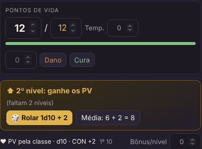
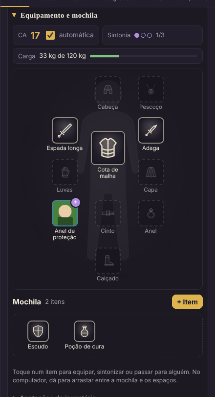
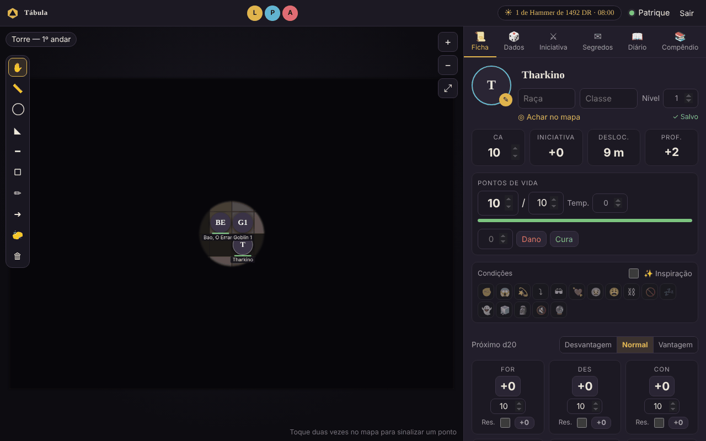

# Novidades

O que chegou em cada versão, e como experimentar. A lista técnica completa está no
[histórico de versões](../CHANGELOG.md); o passo a passo de cada ferramenta, no [manual](ferramentas.md).

**Para atualizar:** feche a mesa e rode `atualizar.bat` (Windows) ou `./atualizar.sh` (Linux e Mac).
A campanha não é tocada. Quando sai uma versão nova, o mestre vê um aviso no topo da mesa.

---

## v5.3 — PV pela classe (01/11/2026)

**A classe define o dado de vida.** Ao escolher a classe na ficha (há uma lista com as do Livro do Jogador), o dado de
vida já vem certo: d12 para o bárbaro, d10 para o guerreiro, d6 para o mago…

**PV que acompanham o nível.** Com **❤ PV pela classe** ligado, o 1º nível vale o máximo do dado + CON, e a cada nível
novo aparece um quadro para **rolar o dado** ou **pegar a média**. A rolagem sai no chat para todos, e os PV máximos e
atuais sobem sozinhos. Se a CON subir, os PV acompanham em todos os níveis. O mestre decide se a mesa deixa o jogador
escolher, sempre rola ou sempre usa a média.

**Experimente:**
1. Escreva **Guerreiro** na classe do seu personagem: aparece "Dado de vida: d10".
2. Clique **❤ PV pela classe (d10)**.
3. Mude o **Nível** para 2 e clique **🎲 Rolar 1d10**.

 

Veja no manual: [Classe, dado de vida e PV por nível](ferramentas.md#classe-dado-de-vida-e-pv-por-nível)

---

## v5.2 — Equipamento e ficha em janela (01/11/2026)

**Equipamento e mochila.** A ficha ganhou um boneco com os espaços do corpo (cabeça, pescoço, capa, armadura,
as duas mãos, luvas, dois anéis, cinto e calçado) e uma mochila. Cada item tem um desenho do tipo dele e a borda na
cor da raridade, e a arte final entra quando você quiser, escolhendo a imagem ou colando com Ctrl+V.

A ficha cuida das regras: arma de duas mãos ocupa as duas, arma versátil pergunta como você vai usar,
no máximo 3 itens sintonizados, CA calculada pela armadura e pelo escudo, ataques das armas equipadas com bônus e
dano já prontos, e a carga contra 7,5 × Força.

**Ficha em janela.** Dois cliques no token (ou **⧉ Em janela**) abrem a ficha por cima do mapa. O mestre pode deixar
a de cada jogador aberta lado a lado. A ficha de um colega abre só para olhar o equipamento.

**Experimente:**
1. Na sua ficha, em **Equipamento e mochila**, clique **+ Item** e escolha o modelo **Espada longa**.
2. Toque na espada e escolha **Equipar com as duas mãos**. Veja o ataque aparecer em **Ataques** com o d10.
3. Crie um **Escudo** e arraste para a mão esquerda: a espada volta para uma mão e a CA passa a contar o escudo (+2).
4. 👑 Na ficha de um jogador, **🎁 Dar item**: ele recebe um aviso na hora.
5. Dê dois cliques no seu token.

 

Veja no manual: [Equipamento e mochila](ferramentas.md#equipamento-e-mochila) ·
[Ficha em janela](ferramentas.md#ficha-em-janela)

---

## v5.1 — Linux e Mac (27/10/2026)

A mesa roda também no **Linux** e no **Mac**, com os atalhos `instalar.sh`, `iniciar.sh`, `online.sh`,
`atualizar.sh` e `redefinir-senha.sh`. O `online.sh` baixa sozinho o programa do link e mostra o endereço para os
jogadores num terminal só; Ctrl + C fecha tudo e salva a campanha.

O `atualizar.bat` passou a atualizar só quando a versão do GitHub é mais nova.

Veja: [Instalação no Linux e no Mac](instalacao-linux.md)

---

## v5 — Névoa, régua e uma ficha mais completa (27/10/2026)

**No mapa:** névoa de guerra (o mestre revela aos poucos; monstros na névoa nem chegam aos jogadores), régua em metros
que todos veem ao vivo, áreas de magia (esfera, cone, linha, cubo), desenho livre, setas e borracha, e as condições
aparecem como ícones nos tokens.

**Na ficha:** condições, inspiração, testes contra a morte com rolagem automática, espaços de magia, dados de vida para o
descanso curto, XP com aviso de subir de nível, moedas, e o **aspecto mágico** e o **anel**, que só o mestre escreve.

**Para o mestre:** calendário do mundo no topo da tela (Harptos, com meses editáveis), descanso curto e longo para o
grupo, **fila de memórias** nos segredos para devolver as memórias uma de cada vez, imagens em lote no bestiário, e o
`atualizar.bat`.

**Experimente:**
1. 👑 Clique em **🌫**, marque **Ligada** e arraste **◯ Revelar** em volta do grupo.
2. Use **📏** para medir até a porta e **◯** para ver quem a bola de fogo pega.
3. 👑 Clique na data no topo e faça um **🌙 Descanso longo**.
4. 👑 Crie um segredo com *Pôr na fila de memórias de…* e libere com **Liberar próxima**.

Veja no manual: [Ferramentas do mapa](ferramentas.md#ferramentas-do-mapa) ·
[Névoa](ferramentas.md#-névoa-de-guerra-) · [Calendário](ferramentas.md#calendário-e-descansos-) ·
[Segredos](ferramentas.md#segredos-e-fila-de-memórias)

---

## Versões anteriores

- **v4.1 (15/10/2026):** a biblioteca de monstros abre de novo (o arquivo ficava fora do pacote).
- **v4 (15/10/2026):** cartões das rolagens na tela, **bestiário** com 334 monstros do SRD, **ajuste de ND**,
  medidor de **dificuldade do encontro** e painel do token de monstro com ataques roláveis.
- **v3 (14/10/2026):** a grade passa a ser definida por quadrados na largura do mapa (token "invisível" em mapas
  grandes), tokens novos piscam para você achar, e a documentação.
- **v2:** pontos de backup, restaurar a campanha e **Salvar e encerrar a sessão**.
- **v1:** diário do grupo, compêndio do mestre e o seletor de fichas.
- **v0:** a primeira mesa: mapa com grade, tokens redondos, ficha, dados, iniciativa e segredos.
